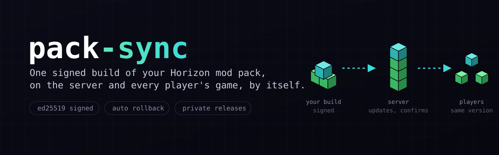
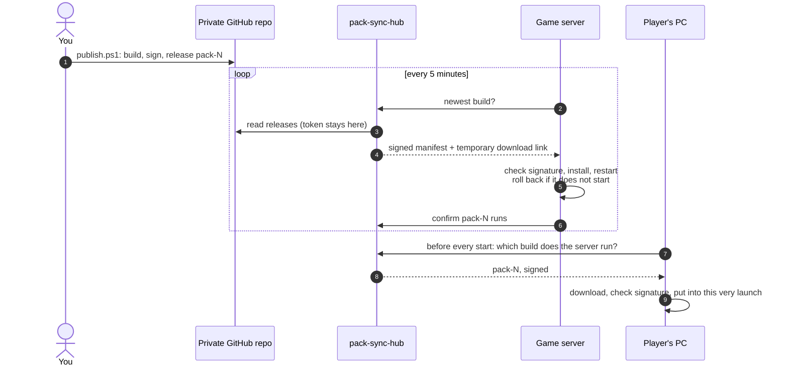

<div align="center">



# pack-sync

**Your Horizon mod pack, on the server and on every player's game. Same version, no manual installs.**

You publish a build once. The game server moves to it within minutes, and each player's game picks it up the next time they press Play.

<a href="https://github.com/Betreazen/horizon-pack-sync/actions/workflows/ci.yml"></a>


<a href="https://github.com/horizon-rust/horizon"></a>

[How it works](#how-it-works) · [For players](#for-players) · [For pack owners](#for-pack-owners) · [Security](docs/security.md) · [API](docs/api.md) · [**По-русски**](README.ru.md)

</div>

<br>

## Why

[Horizon](https://github.com/horizon-rust/horizon) is Minecraft: Java Edition rewritten in Rust, and its native mods are compiled into the game itself. A new version of any mod therefore means a new build of the whole game, for the server and for every player, and the versions must match or the server turns players away.

Doing that by hand means asking every player to download, import and select a new build each time a mod changes. pack-sync does it for them, and checks every build against your signature before it runs anything.

## How it works



1. **You publish.** `publish.ps1` compiles your mods into a Windows client and a Linux server engine, packs content mods (assets and data) beside them, signs a manifest with your private key, and uploads everything to a release `pack-N` of a private GitHub repository.
2. **The server follows.** `pack-sync server` runs next to `horizon-server`. It finds the new build, warns players in chat, backs up the world, switches the engine and restarts. If the new build does not stay up, it goes back to the previous one and never tries that build again.
3. **Players follow the server.** The Horizon launcher runs `pack-sync client` before every start. Players only ever get the build the server has confirmed, so nobody arrives with a newer version than the server.

The hub is the only piece that talks to GitHub. Run the ready-made `pack-sync-hub`, or mount the same API in a site of your own.

## Features

- 🔏 **Signed builds.** ed25519 signatures with an offline key. A stolen GitHub account or hub cannot push code to players: anything not signed by you is refused.
- 🔁 **Never ahead of the server.** Players receive only the build the server confirmed. Build numbers only grow, so an old build cannot be replayed.
- ⚡ **Works in the same launch.** The update lands in the copy of the game the launcher is about to start, so one press of Play is enough.
- 🛟 **Automatic rollback.** A server build that fails to start is undone and remembered as bad.
- 🔒 **Private by design.** The GitHub token never leaves the hub, files come through short-lived GitHub links, and players get personal codes you can revoke. Players never receive the server build, which carries files made from the game.
- 🎮 **The game always starts.** No network, no hub, a bad download: the player plays on the build they have, and the reason goes to a log.
- 🧩 **Made for Horizon's launcher.** It creates a profile, pins it to your build, and uses the launcher's own pre-launch hook. Nothing is patched.

## For players

You need the [Horizon launcher](https://github.com/horizon-rust/horizon), signed in with an account that owns Minecraft: Java Edition, and the game started once.

1. Get **`pack-sync.exe`** and a **personal code** from your server's owner (on some servers the code is in your profile on the site).
2. Run `pack-sync.exe setup`, read the notice and agree, then paste your code.
3. In the launcher, pick the new profile and press **Play**.

From then on the game updates itself before every start. To remove it, delete the profile in the launcher and the folder `%LOCALAPPDATA%\PackSync\<profile>`.

> [!NOTE]
> Horizon mods are native code with full access to your computer. Install pack-sync only for a server whose owner you trust: their signature is what decides which code runs.

## For pack owners

The full walkthrough, with every command and what to do when something fails, is in **[docs/owner-guide.md](docs/owner-guide.md)**. The short version:

**You need:** a Windows PC with the Horizon launcher, [Rust](https://rustup.rs), [Docker Desktop](https://www.docker.com/products/docker-desktop/) and the [GitHub CLI](https://cli.github.com); a Linux x86-64 server for the game (it can host the hub too); and a domain name for the hub's HTTPS.

1. **Make your signing key.**
   ```powershell
   cargo run -p pack-sync -- keygen --out C:\keys\pack.key
   ```
   It prints the public key. Keep `pack.key` out of every repository.
2. **Create a private repository for the pack** with two files: `pack.json` (which mods, on which Horizon) and `pack-sync.toml` (your hub's address, the profile name, the installer's language and the public key). Templates: [pack.example.json](docs/pack.example.json) and [pack-sync.example.toml](pack-sync/pack-sync.example.toml).
3. **Create a read-only token** for that repository: [prefilled form](https://github.com/settings/personal-access-tokens/new?name=pack-sync-hub&description=Reads+mod+pack+releases&expires_in=366&contents=read), then pick *Only select repositories*.
4. **Start the hub** on your server and put HTTPS in front of it ([Caddyfile.example](scripts/hub/Caddyfile.example)):
   ```powershell
   .\scripts\hub\deploy-hub.ps1 -SshHost myvps -PackDir C:\my-pack -ServerKeyFile C:\keys\pack-server.key
   ```
5. **Set up the game server** in one command:
   ```powershell
   .\scripts\game-server\deploy-game-server.ps1 -SshHost myvps -PackDir C:\my-pack `
       -ServerKeyFile C:\keys\pack-server.key -Player YourNick -AcceptEula
   ```
6. **Publish your first build**, after reading the mods you ship:
   ```powershell
   .\scripts\publish.ps1 -PackDir C:\my-pack -KeyFile C:\keys\pack.key -TrustNativeCode
   ```
7. **Invite players:** give them `target\release\pack-sync.exe` and a code from `pack-sync-hub code add <name>`.

> [!IMPORTANT]
> `-TrustNativeCode` is your decision that the mods may run with full rights. Horizon's rules say only a person makes it, never an AI agent, so the scripts never pass it for you.

## What's in the repository

```
pack-sync/          the updater: player client, server service, installer, signing
hub/                pack-sync-hub: the API as a program, and as a library for your own site
scripts/
  publish.ps1       build, sign and release a pack
  build-linux.sh    Linux binaries in Docker
  docker/           the Linux image that builds the server engine
  game-server/      one-command install of horizon-server + pack-sync on a VPS
  hub/              one-command install of pack-sync-hub, Caddy example
docs/               owner guide, security model, API, design notes
```

## FAQ

<details>
<summary><b>Why are there no ready-made downloads in Releases?</b></summary>

Your public key and your hub's address are built into `pack-sync.exe`, so a player's copy can only ever accept your builds from your hub. Every pack owner builds their own; `publish.ps1` does it on the way.
</details>

<details>
<summary><b>Does it work with Java mods, Fabric or other launchers?</b></summary>

No. It installs builds of the Horizon game with Horizon native mods, through the Horizon launcher.
</details>

<details>
<summary><b>Which systems are supported?</b></summary>

Players on Windows x64, game servers on Linux x86-64. The owner builds on Windows. Other targets are not built yet.
</details>

<details>
<summary><b>What happens when I change the Horizon version the pack is built on?</b></summary>

The server moves as usual. A player's next start installs the new game files and asks them to press Play once more: the launch already under way cannot switch its files.
</details>

<details>
<summary><b>Can I use my own website instead of pack-sync-hub?</b></summary>

Yes. The hub is also a library: mount `pack_sync_hub::router` in your axum site and implement `AccessStore` on top of your accounts. See [docs/api.md](docs/api.md).
</details>

<details>
<summary><b>Is this an official Horizon project?</b></summary>

No. It is an independent tool for servers running Horizon, built on the launcher's public command line and hooks.
</details>

## Status

Running on the author's server since November 2026. Covered by 119 tests. Checked end to end: the server installs new builds by itself, confirms them, and players install and join. Swapping a player's game for a build with a different binary in the same launch is covered by tests and is waiting for its first live run.

## License

[MIT](LICENSE). Horizon and its launcher are a separate project under their own license.
