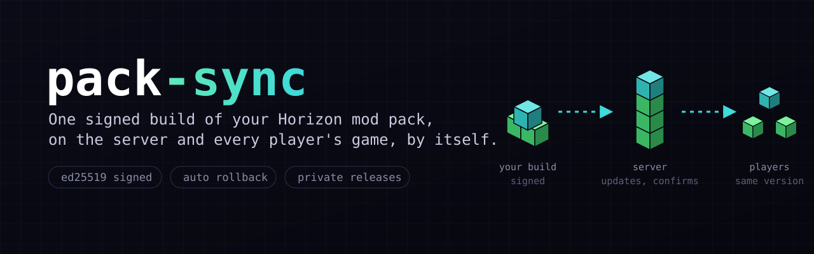
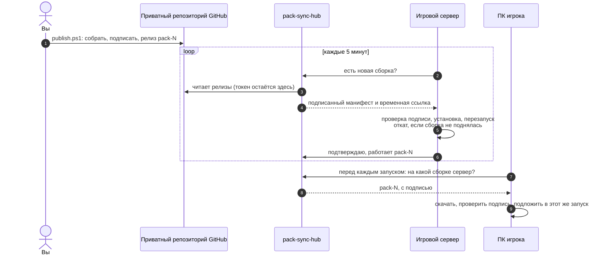

<div align="center">



# pack-sync

**Ваша сборка модов Horizon на сервере и у каждого игрока. Одна версия, без ручной установки.**

Вы выпускаете сборку один раз. Сервер переходит на неё за несколько минут, а игра каждого игрока получает её при следующем нажатии «Играть».

<a href="https://github.com/Betreazen/horizon-pack-sync/actions/workflows/ci.yml"></a>


<a href="https://github.com/horizon-rust/horizon"></a>

[Как это работает](#как-это-работает) · [Игрокам](#игрокам) · [Владельцам сборки](#владельцам-сборки) · [Безопасность](docs/security.md) · [API](docs/api.md) · [**English**](README.md)

</div>

<br>

## Зачем

[Horizon](https://github.com/horizon-rust/horizon) — это Minecraft: Java Edition, переписанный на Rust. Его нативные моды компилируются прямо в игру. Поэтому новая версия любого мода означает новую сборку всей игры, и для сервера, и для каждого игрока. Версии должны совпадать, иначе сервер не пустит игрока.

Вручную это значит каждый раз просить всех игроков скачать, импортировать и выбрать новую сборку. pack-sync делает это за них. Перед запуском чего-либо он сверяет каждую сборку с вашей подписью.

## Как это работает



1. **Вы выпускаете сборку.** `publish.ps1` компилирует моды в клиент для Windows и движок сервера для Linux, подписывает манифест вашим закрытым ключом и выкладывает все три файла релизом `pack-N` в приватный репозиторий GitHub.
2. **Сервер следует за сборкой.** `pack-sync server` работает рядом с `horizon-server`. Он находит новую сборку, предупреждает игроков в чате, делает копию мира, переключает движок и перезапускает сервер. Если новая сборка не держится, он возвращает прошлую и больше эту сборку не пробует.
3. **Игроки следуют за сервером.** Лаунчер Horizon запускает `pack-sync client` перед каждым стартом игры. Игроки получают только сборку, которую подтвердил сервер, поэтому никто не придёт с версией новее серверной.

С GitHub общается только hub. Можно запустить готовый `pack-sync-hub` или встроить тот же API в свой сайт.

## Возможности

- 🔏 **Подписанные сборки.** Подпись ed25519 ключом, который хранится у вас. Украденный аккаунт GitHub или hub не может подсунуть игрокам код: всё, что не подписано вами, отклоняется.
- 🔁 **Игрок никогда не обгоняет сервер.** Игроки получают только подтверждённую сервером сборку. Номера сборок только растут, так что старую сборку не подсунуть повторно.
- ⚡ **Срабатывает в том же запуске.** Обновление попадает в ту копию игры, которую лаунчер сейчас запустит, поэтому достаточно одного нажатия «Играть».
- 🛟 **Автоматический откат.** Сборка, которая не запустилась на сервере, отменяется и запоминается как плохая.
- 🔒 **Приватность.** Токен GitHub не покидает hub, файлы скачиваются по короткоживущим ссылкам GitHub, у игроков личные коды, которые можно отозвать. Серверную сборку игроки не получают: в ней есть файлы, сделанные из файлов игры.
- 🎮 **Игра запускается всегда.** Нет сети, недоступен hub, испорченная загрузка — игрок играет на той сборке, что есть, а причина пишется в журнал.
- 🧩 **Сделан для лаунчера Horizon.** Создаёт профиль, закрепляет его за вашей сборкой и использует собственный механизм лаунчера для команды перед запуском. Ничего не патчится.

## Игрокам

Нужен [лаунчер Horizon](https://github.com/horizon-rust/horizon) с входом в аккаунт, которому принадлежит Minecraft: Java Edition, и хотя бы один запуск игры.

1. Получите у владельца сервера **`pack-sync.exe`** и **личный код** (на некоторых серверах код есть в профиле на сайте).
2. Запустите `pack-sync.exe setup`, прочитайте предупреждение, согласитесь и вставьте код.
3. В лаунчере выберите новый профиль и нажмите **«Играть»**.

Дальше игра обновляется сама перед каждым запуском. Чтобы удалить pack-sync, удалите профиль в лаунчере и папку `%LOCALAPPDATA%\PackSync\<профиль>`.

> [!NOTE]
> Моды Horizon — нативный код с полным доступом к компьютеру. Ставьте pack-sync только для сервера, владельцу которого доверяете: какой код запустится, решает его подпись.

## Владельцам сборки

Полная инструкция со всеми командами и разбором ошибок — в **[docs/owner-guide.md](docs/owner-guide.md)** (на английском). Коротко:

**Понадобятся:** ПК на Windows с лаунчером Horizon, [Rust](https://rustup.rs), [Docker Desktop](https://www.docker.com/products/docker-desktop/) и [GitHub CLI](https://cli.github.com); сервер на Linux x86-64 для игры (на нём же может работать hub); доменное имя для HTTPS у hub.

1. **Создайте ключ подписи.**
   ```powershell
   cargo run -p pack-sync -- keygen --out C:\keys\pack.key
   ```
   Команда напечатает открытый ключ. Файл `pack.key` не должен попасть ни в один репозиторий.
2. **Создайте приватный репозиторий сборки** с двумя файлами: `pack.json` (какие моды и на какой версии Horizon) и `pack-sync.toml` (адрес hub, имя профиля, язык установщика и открытый ключ). Образцы: [pack.example.json](docs/pack.example.json) и [pack-sync.example.toml](pack-sync/pack-sync.example.toml).
3. **Создайте токен только на чтение** этого репозитория: [заполненная форма](https://github.com/settings/personal-access-tokens/new?name=pack-sync-hub&description=Reads+mod+pack+releases&expires_in=366&contents=read), затем выберите *Only select repositories*.
4. **Запустите hub** на сервере и поставьте перед ним HTTPS ([Caddyfile.example](scripts/hub/Caddyfile.example)):
   ```powershell
   .\scripts\hub\deploy-hub.ps1 -SshHost myvps -PackDir C:\my-pack -ServerKeyFile C:\keys\pack-server.key
   ```
5. **Установите игровой сервер** одной командой:
   ```powershell
   .\scripts\game-server\deploy-game-server.ps1 -SshHost myvps -PackDir C:\my-pack `
       -ServerKeyFile C:\keys\pack-server.key -Player ВашНик -AcceptEula
   ```
6. **Выпустите первую сборку**, прочитав код модов, которые в неё входят:
   ```powershell
   .\scripts\publish.ps1 -PackDir C:\my-pack -KeyFile C:\keys\pack.key -TrustNativeCode
   ```
7. **Пригласите игроков:** дайте им `target\release\pack-sync.exe` и код из `pack-sync-hub code add <имя>`.

> [!IMPORTANT]
> `-TrustNativeCode` — ваше решение, что моды могут работать с полными правами. По правилам Horizon его принимает только человек, а не ИИ-агент, поэтому скрипты никогда не ставят этот флаг за вас.

## Что в репозитории

```
pack-sync/          обновлятор: клиент игрока, служба сервера, установщик, подпись
hub/                pack-sync-hub: API как программа и как библиотека для своего сайта
scripts/
  publish.ps1       собрать, подписать и выпустить сборку
  build-linux.sh    бинарники для Linux в Docker
  docker/           образ Linux, в котором собирается движок сервера
  game-server/      установка horizon-server и pack-sync на VPS одной командой
  hub/              установка pack-sync-hub одной командой, пример для Caddy
docs/               инструкция владельца, модель безопасности, API, заметки о дизайне
```

## Вопросы и ответы

<details>
<summary><b>Почему в релизах нет готовых файлов?</b></summary>

В `pack-sync.exe` вшиты ваш открытый ключ и адрес вашего hub, поэтому копия у игрока принимает только ваши сборки и только от вашего hub. Каждый владелец собирает свою копию, и `publish.ps1` делает это по ходу.
</details>

<details>
<summary><b>Работает ли с Java-модами, Fabric или другими лаунчерами?</b></summary>

Нет. pack-sync ставит сборки игры Horizon с нативными модами Horizon через лаунчер Horizon.
</details>

<details>
<summary><b>Какие системы поддерживаются?</b></summary>

Игроки на Windows x64, игровые серверы на Linux x86-64. Владелец собирает на Windows. Другие платформы пока не собираются.
</details>

<details>
<summary><b>Что будет, если сменить версию Horizon, на которой собрана сборка?</b></summary>

Сервер перейдёт как обычно. У игрока следующий запуск поставит новые файлы игры и попросит нажать «Играть» ещё раз: уже начатый запуск не может сменить свои файлы.
</details>

<details>
<summary><b>Можно ли вместо pack-sync-hub использовать свой сайт?</b></summary>

Да. Hub — это ещё и библиотека: подключите `pack_sync_hub::router` к своему сайту на axum и реализуйте `AccessStore` поверх своих аккаунтов. Подробности в [docs/api.md](docs/api.md).
</details>

<details>
<summary><b>Это официальный проект Horizon?</b></summary>

Нет. Это независимый инструмент для серверов на Horizon, построенный на публичной командной строке и механизмах лаунчера.
</details>

## Состояние

С ноября 2026 года работает на сервере автора, покрыт 97 тестами. Вживую проверено: сервер сам ставит новые сборки и подтверждает их, игроки ставят сборку и заходят на сервер. Замена файла игры на сборку с другим бинарником прямо в запуске покрыта тестами и ждёт первой проверки вживую.

## Лицензия

[MIT](LICENSE). Horizon и его лаунчер — отдельный проект со своей лицензией.
